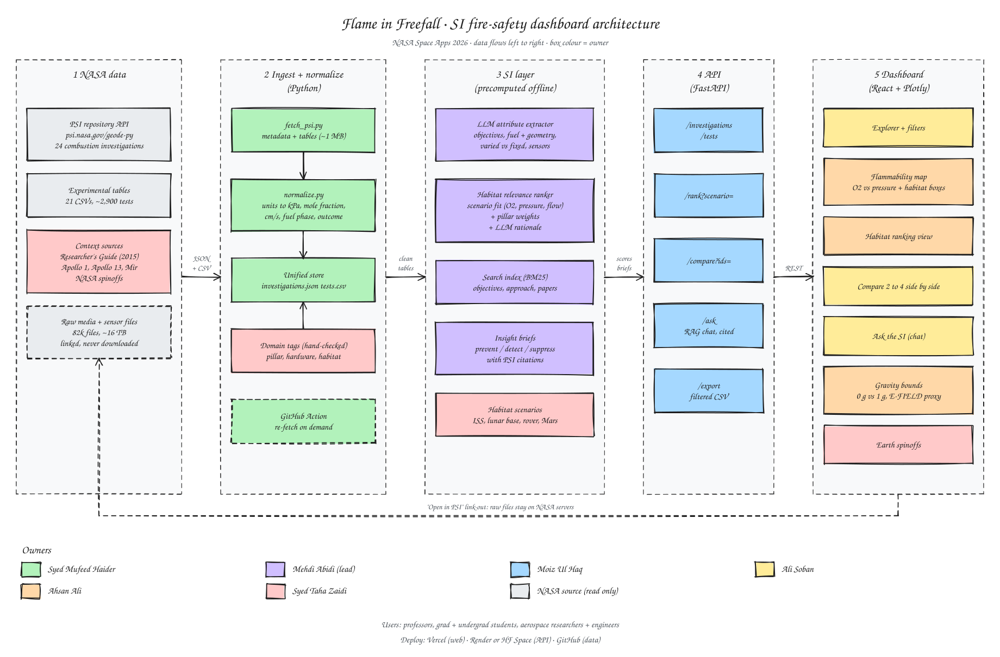

# Flame in Freefall

**An SI-powered fire safety dashboard built on NASA's microgravity combustion data.**

**Live dashboard: https://mehdi-abidi.github.io/flame-in-freefall/**
NASA Space Apps Challenge 2026 · [Flame in Freefall challenge](https://www.spaceappschallenge.org/2026/challenges/flame-in-freefall/)

NASA has flown dozens of fire experiments on the International Space Station. The results sit in the [Physical Sciences Informatics (PSI)](https://psi.nasa.gov/physci/repo/search?data_source=psi&data_type=investigation) repository as 24 combustion investigations, about 2,900 logged tests and more than 82,000 raw files. That is a lot to search through when you are designing a lunar habitat and need to know how a fabric burns at 30% oxygen.

This dashboard reads that data, ranks every investigation for a chosen habitat (ISS, lunar base, pressurized rover, Mars habitat), plots exactly which oxygen and pressure conditions were tested, and answers questions with citations back to PSI.

## Architecture



The editable source is [`docs/architecture.excalidraw`](docs/architecture.excalidraw). To change it, open [excalidraw.com](https://excalidraw.com), choose *Open*, and pick that file. Export it as SVG over `docs/architecture.svg` when you are done.

Data flows left to right:

1. **NASA data.** The PSI search API gives metadata for all 24 combustion investigations. Each investigation also has an "experimental table" CSV that lists the conditions of every test. Raw videos and sensor dumps (about 16 TB) stay on NASA's servers and are linked, never downloaded.
2. **Ingest and normalize.** `pipeline/fetch_psi.py` pulls metadata and tables (under 1 MB). `normalize.py` converts mmHg, atm and bar to kPa, percent to mole fraction, and tags fuel phase and outcome.
3. **SI layer.** An LLM extracts structured attributes from each investigation (fuel, sample geometry, variables varied and held fixed, sensors). A transparent scoring formula ranks investigations per habitat, and the LLM writes the explanation. All of this is precomputed and committed.
4. **API.** FastAPI serves investigations, tests, rankings, comparisons, CSV export and a cited Q&A endpoint.
5. **Dashboard.** A Next.js static site with hand-built SVG charts. Pages: Overview (oxygen ruler, gap map, gravity table), Rank, Investigations, Compare, Ask, Back on Earth, Method.

## What it answers

| Challenge objective | Dashboard feature |
|---|---|
| Find investigations most relevant to spacecraft, stations, lunar and Martian bases, pressurized rovers | Habitat Ranking with adjustable prevention, detection and suppression weights |
| Extract data for predictive modeling of flammability | Unified test matrix (O2, pressure, flow, fuel, outcome) with filtered CSV export |
| Highlight research for next-generation fire safety equipment | Insight briefs per pillar, Earth spinoffs page |
| Summarize objectives, fuels, conditions, variables, sensors | Explorer cards and the Compare view |
| Show similarities and differences between investigations | Compare 2 to 4 investigations side by side, differences highlighted |
| Partial gravity | Gravity Bounds panel: microgravity vs 1 g results (SAFFIRE-II), E-FIELD as a proxy |

## Data

Everything comes from NASA PSI's public API. No login is needed.

| Endpoint | Returns |
|---|---|
| `GET https://psi.nasa.gov/geode-py/ws/repo/search?data_source=psi&data_type=investigation&ffield=Research%20Area&fvalue=combustion%20science` | All 24 combustion investigations |
| `GET https://psi.nasa.gov/geode-py/ws/repo/investigations/PSI-69` | Full metadata for one investigation |
| `GET https://psi.nasa.gov/geode-py/ws/repo/investigations/PSI-69/versions` | File manifest |
| `GET https://psi.nasa.gov/geode-py/ws/studies/PSI-69/download?file=<id>&version=1&redirect=false` | Temporary download link for one file |

Already pulled into this repo:

| Path | Contents |
|---|---|
| `data/raw/catalog.json` | Search results for the 24 investigations |
| `data/raw/investigations/PSI-*.json` | Full metadata per investigation (objectives, approach, hardware, publications) |
| `data/raw/tables/*.csv` | 21 experimental tables, about 2,900 test rows |
| `data/raw/index.json` | Summary per investigation, including raw file counts and sizes on PSI |
| `data/processed/tests.csv` | 2,127 normalized rows, each with a unique `row_id`: fuel, phase, geometry, size, O2 fraction, pressure in kPa, flow, outcome |
| `data/processed/investigations.json` | 24 investigation records: metadata, publications, test counts, O2 and pressure ranges with their basis (measured, nominal, planned) |
| `data/processed/extracted.json` | AI-extracted facts per investigation: plain summary, fuels, geometry, variables varied and held fixed, sensors, measurements, fire-safety pillars, Earth benefits, plus review warnings |
| `data/processed/rankings.json` | All 24 investigations ranked for each habitat (ISS, lunar base, pressurized rover, Mars habitat, spacesuit) with score breakdown and reasons |
| `data/processed/rationale.json` | Two-sentence explanation of every rank, per habitat, validated against the score facts |
| `data/processed/briefs.json` | One cited insight brief per fire-safety pillar, with review status |
| `data/domain/scenarios.json` | Habitat O2 and pressure targets, each with its source sentence and labelled assumptions |
| `data/domain/seed_pillars.json` | Seed fire-safety tags from the plan, replaced by hand-checked tags in T1 |
| `data/processed/saffire2_gravity.csv` | SAFFIRE-II microgravity vs 1 g burn results, sample by sample |

Every O2 and pressure value carries a source tag (`measured`, `planned`, `nominal_cabin_air` and so on), so assumed cabin values are never mistaken for test conditions. Table-by-table units and cleanup decisions are in [`docs/data-notes.md`](docs/data-notes.md).

### What the data already shows

- **No solid-material fire test in PSI ran above 22.2% oxygen.** That covers 140 tests across BASS-II, SAFFIRE-I and SAFFIRE-II. Lunar habitats are expected to run at 30% or more.
- **Only 20 tests sit at lunar-base conditions** (30% O2 or more at 70 kPa or less), and all of them are gas flames from ACME CFI-G. Inverse flames are not counted: their oxygen came from the burner into a fuel-filled chamber, so they say nothing about a cabin atmosphere.
- **Gravity flips the ranking of materials.** In SAFFIRE-II, thin silicone sheets burned completely at 1 g but barely burned in microgravity, while cotton-fiberglass fabric spread its full 29 cm length in both.

## Progress

| Task | Owner | Status |
|---|---|---|
| Repo, architecture, execution plan | Mehdi | Done |
| D1 to D4 Units, `normalize.py`, `tests.csv`, `qa.py` | Mufeed | Done |
| D5 Merge extraction and hand-checked tags into `investigations.json` | Mufeed | Done |
| S1 to S3 LLM client, AI extraction, habitat ranking engine | Mehdi | Done |
| S4 to S5 Rank explanations and insight briefs | Mehdi | Done. The three briefs were redrafted and reviewed in T4 |
| S6 Merges, deploy checks, submission | Mehdi | Sunday |
| A1 to A5 FastAPI service, live on Render, see [API](#api) | Moiz | Done |
| F1 to F4, V1 to V4 Dashboard (`web/`), live on GitHub Pages | Mehdi | Done |
| F5 Ask page against `/ask` | Ali Soban | Done |
| F6 Submission text draft | Ali Soban | Done |
| V2 and V4 Gap map label tuning, partial-gravity note | Ahsan | Done |
| T1 Hand-checked pillar tags | Taha | Done. All 24 signed off, Saffire platforms corrected to Cygnus |
| T2 Habitat scenarios | Taha | Done |
| T4 Review of the extraction and the briefs | Taha | Done. Briefs reviewed, a false sensor warning cleared |
| T5 Demo video and slides, polish of the submission text | Taha | Sunday afternoon |

## Dashboard (`web/`)

Next.js 16 static export, deployed to GitHub Pages by `.github/workflows/dashboard.yml` on every push to `main`. Pull requests get lint, type-check, tests and a full build first.

| Page | What it does |
|---|---|
| Mission brief | The home page, told as one scroll. A hero with the headline gap, a scroll scene where NASA's candle flame loses gravity and turns from a teardrop into a blue dome, the 22.2% versus 30% gap, live verdicts for three cabins, the five-step data pipeline with the number each step produced, and a grid of the tools |
| Evidence | The oxygen ruler, the gap map of every test by oxygen and pressure with habitat boxes, the SAFFIRE-II gravity comparison, the three reviewed briefs, a FLEX comparison of how droplet flames went out by diluent, four data-backed experiments to fly next, and a button that downloads the whole normalized test table as CSV |
| Cabin lab | Set oxygen, pressure, fuel and gravity for a cabin of your own, or pick a habitat or one of the two cabin atmospheres NASA's BRE record names for human missions. A map shows every test as a dot and a box around your cabin, so the count of tests near it is visible. It says how those tests ended and how far the cabin sits past the record, and draws the flame solid only where tests exist |
| Wisp, the guide | A small companion on every page. It answers greetings, explains any word on the screen using what the page shows right now, checks a habitat's cabin with a card counted from the flight tests, and takes the visitor where they ask to go, all from code. Anything else goes to the live `/guide` API, which may use the dashboard's own description, the visitor's screen and retrieved PSI passages, and cites only passages it was given. An off-topic question gets a light joke and a way back. Questions can be typed or spoken, and answers can be read aloud |
| Rank | Habitat switcher and pillar sliders. The list re-orders live, arrows show movement, each row opens its evidence. State lives in the URL, so a view can be shared |
| Investigations | Search and filter all 24, then a page per investigation with summary, conditions, its tests on the map and every publication |
| Compare | Up to four side by side, differences marked |
| Ask | Plain-English questions answered from NASA's records by the live API, each answer with its PSI citations |
| Method | Pipeline, score parts, habitat sources, honesty rules, limits, AI-use disclosure |
| Back on Earth | A short history of spacecraft fires, and the uses on Earth that 21 investigations name in their own NASA records, grouped into smoke detection, confined spaces and cleaner engines |

Design: one dark mission-console theme. Barlow Condensed capitals for headings, Host Grotesk for text, JetBrains Mono for data, flame orange for every action, ice blue for freefall and red for the gap. NASA photographs carry the hero and chapters, charts are hand-built SVG, every page ends with its next stage, and an excerpt of Scott Buckley's 'Signal to Noise' (CC-BY 4.0) plays after the first click, loops, and pauses and resumes from the header button. Chart colours come from a colourblind-validated palette, text never uses data colours, every chart has a table view, and motion respects reduced-motion settings. Ranking runs in the browser with the same formula as `si/rank.py`, and a test checks all 120 scores match.

```bash
cd web
npm ci
npm run dev        # http://localhost:3000
npm test           # data loader and ranking parity
```

The site is fully static and needs no API key. The `LLM_API_KEY` repository secret is reserved for build-time AI jobs. A live chat needs a backend that holds the key, never the browser.

## Habitat ranking (S3)

```bash
python -m si.rank --scenario lunar_base                    # top 10 for the lunar base
python -m si.rank --scenario iss --weights detection=2     # favour detection research
python -m si.rank --scenario mars_habitat --json           # full result as JSON
python -m si.rank --write                                  # rebuild rankings.json (CI does this too)
```

Each investigation gets a score from 0 to 1, with every part shown so a judge can see why something ranks first:

| Part | Weight | What it measures |
|---|---|---|
| Condition fit | 0.35 | How close its tests came to the habitat's O2 and pressure box. Distance is counted in tolerances (0.05 O2, 20 kPa). Measured values count fully, assumed cabin values half. Half best test, half typical test. |
| Material relevance | 0.20 | Solid 1.0, liquid 0.7, gas 0.5, dust 0.4. Habitat fires start in solids. |
| Pillar match | 0.25 | 1.0 if it covers the user's highest-weighted pillar. Uses the best single pillar, so extra tags do not inflate a score. |
| Data richness | 0.20 | Log-scaled tests, files and publications. |

Pillars come from Taha's hand-checked `data/domain/tags.json` when it exists, then the seed tags, then the model's suggestions, and each result says which one it used.

**For the API (A2):** call `si.rank.rank(scenario_id, weights, inputs)` with `inputs = load_inputs()` loaded once at startup. A `UsageError` (unknown scenario, bad weights) should become HTTP 400 with its message. Any other `RankError` is a data problem and should become HTTP 500. The CLI exits with 2 for usage errors, 1 for data errors and 130 on Ctrl+C. `--debug` shows the full traceback for unexpected errors.

## Rank explanations (S4)

```bash
python -m si.rationale --model openai/gpt-oss-120b   # 72 calls: lunar base, rover and Mars share one target box
python -m si.rationale --templates-only               # no key needed, fact-only sentences
python -m si.rationale --only PSI-69 --force          # rewrite one investigation
```

The model only turns facts that the ranking already computed into two sentences. Code works out what is distinctive (the part that lifts an investigation most above the other 23, and any part genuinely below them) and how its conditions were recorded, so the model never has to guess. Each reply is checked before it is kept:

- exactly two sentences, at most 70 words, no dashes or semicolons
- it names the investigation, uses plain words (no field names) and writes numbers as digits
- every number must appear in the facts (percent and fraction forms allowed)
- any stated rank must be the real rank
- it may not say tests were inside the target when none were (negations such as "none were inside" are fine)

A rejected reply is sent back once with the exact problems. If it fails again, a fact-only template is used and labelled as such. Runs resume: entries whose facts did not change are kept, so reruns cost nothing. `--strict` exits 1 if anything fell back. QA fails if a rationale no longer matches the current rank, and the dashboard hides any rationale written for a different rank.

## Insight briefs (S5)

```bash
python -m si.briefs --model openai/gpt-oss-120b   # three briefs: prevention, detection, suppression
python -m si.briefs --templates-only               # fact-only briefs, no key needed
python -m si.briefs --pillar suppression --force   # rewrite one
```

Each brief has a title, three findings that cite PSI accessions, what it means for a lunar base, and what the data does not cover. Code gathers the facts per pillar (oxygen and pressure ranges with their basis, recorded outcomes such as the lowest oxygen at which droplets went out, the SAFFIRE-II gravity comparison, the 22.2% and lunar-condition test headlines). The model writes. Every brief is checked before it is kept:

- each finding names the investigation it cites, and cites only investigations in that pillar
- flames are only said to go out where an extinction is recorded
- assumed or planned oxygen is called assumed or planned next to the number
- no superlatives (best, most effective) and no reassurance (can rely on, is effective, safe enough)
- every number comes from the facts, digits only, no field names, word limits

A rejected brief is sent back with the exact problems, up to three attempts, then a fact-only brief is used. Briefs start as "awaiting expert review". A review mark is kept on rerun unless the facts change. QA fails if pillar membership changes, for example when hand-checked tags land, until the briefs are rerun.

## Team

| Member | Role |
|---|---|
| Mehdi Abidi | Team lead, SI layer, integration |
| Syed Mufeed Haider | Data engineering |
| Moiz Ul Haq | Backend API |
| Ali Soban | Frontend |
| Ahsan Ali | Data visualization |
| Syed Taha Zaidi | Domain research, demo and submission |

The full hour-by-hour plan, task board, data contracts and ranking formula are in [`docs/EXECUTION_PLAN.md`](docs/EXECUTION_PLAN.md) and [`docs/Execution_Plan.pdf`](docs/Execution_Plan.pdf).

## Getting started

```bash
git clone https://github.com/Mehdi-Abidi/flame-in-freefall.git
cd flame-in-freefall
python -m venv .venv
.venv\Scripts\activate
pip install -r requirements.txt
copy .env.example .env
python -m si.llm --check
python pipeline/fetch_psi.py
python pipeline/normalize.py
python pipeline/build_investigations.py
python pipeline/merge_extraction.py
python pipeline/qa.py
```

Put your own free [Groq](https://console.groq.com/keys) key into `.env` as `LLM_API_KEY` before running `si.llm --check`. Never commit `.env`. The fetch and normalize steps are optional because the data is already committed. The fetch downloads under 1 MB.

### LLM setup

`si/llm.py` talks to any OpenAI-compatible provider. Switching provider or model means editing `.env`, not code.

| Setting | Default | Notes |
|---|---|---|
| `LLM_BASE_URL` | `https://api.groq.com/openai/v1` | OpenRouter, Cerebras and NVIDIA also work |
| `LLM_MODEL` | `openai/gpt-oss-20b` | Open-weight. Scored best in our extraction test (12 of 12 facts present in the text, 0.6 s) |
| `LLM_FALLBACK_MODEL` | `openai/gpt-oss-120b` | Used automatically if the main model fails |

Replies are cached in `.cache/llm/` so reruns do not spend free-tier quota. Rate limits are retried with backoff.

### AI extraction (S2)

```bash
python -m si.extract                  # all 24 investigations, about 4 minutes on the Groq free tier
python -m si.extract --only PSI-69    # redo one investigation, keeps the others (unknown IDs are rejected)
python -m si.extraction_report        # rewrite docs/extraction-review.md
```

How it stays honest:

- Facts already proven by the tables (fuels, phases, geometry, O2 and pressure ranges with their basis) are passed to the model as ground truth. Fuel phase and sample size are written from the data, not by the model.
- Which conditions varied and which stayed fixed is computed from `tests.csv`. The tables win over the model, and a summary that calls a varied condition constant (or the reverse) is flagged and fails QA.
- Any fuel or sensor the model names that does not appear in the source text or data is flagged as a warning.
- A detection pillar is dropped unless the source mentions smoke, aerosols, particles, dust or detectors.
- Model pillars are suggestions. [`docs/extraction-review.md`](docs/extraction-review.md) compares them with the seed tags so a person can decide.

## API

FastAPI service in `api/` (tasks A1 to A5). It reads `data/processed` at startup.

**Live:** <https://flame-in-freefall-api.onrender.com> (interactive docs at [`/docs`](https://flame-in-freefall-api.onrender.com/docs)). It runs on Render's free plan, so it sleeps after 15 minutes without traffic and the first request after that takes about 50 seconds. Open the link a few minutes before a demo.

```bash
uvicorn api.main:app --reload     # then open http://127.0.0.1:8000/docs
python -m unittest tests.test_api -v
```

| Endpoint | Returns |
|---|---|
| `GET /health` | Status and row counts |
| `GET /investigations` | All 24 records from `investigations.json` |
| `GET /investigations/{accession}` | One record, for example `PSI-69` (case-insensitive) |
| `GET /tests?accession=&o2_min=&o2_max=&p_min=&p_max=&measured_only=&record_type=` | Rows of `tests.csv`. `accession` takes a comma-separated list. O2 is a mole fraction (0 to 1), pressure is kPa. A bound drops rows with no value for it. |
| `GET /export?...` | Same filters as `/tests`, downloaded as CSV |
| `GET /scenarios` | `tolerance` and the five habitat targets from `data/domain/scenarios.json` |
| `GET /rank?scenario=lunar_base&w_prevent=1&w_detect=1&w_suppress=1&limit=` | `si.rank.rank()` output: per investigation `score`, `components`, `pillars`, `pillar_source`, `evidence`, `reasons`, `rank`. Unknown scenario or bad weights give 400, data problems give 500. |
| `GET /compare?ids=PSI-69,PSI-68` | 2 to 4 investigations. `rows` lists each field with its values and a `differs` flag |
| `POST /ask` `{"question": "..."}` | `answer`, `covered`, `citations` (accessions), `sources` (the retrieved passages). Returns 503 if the server has no `LLM_API_KEY`. |
| `POST /guide` `{"question": "...", "page": "...", "screen": "..."}` | Wisp, the conversational guide: `answer` and `citations`. It may use a fixed description of the dashboard, the text of the visitor's screen and retrieved PSI passages. It cites only passages it was given, never predicts fire behaviour, and shares the `/ask` rate limits. Returns 503 if the server has no `LLM_API_KEY`. |

`/rank` loads the ranking inputs once at startup and calls `si/rank.py` (S3).

`/ask` searches PSI objectives, approaches, hypotheses, publication titles and the S2 summaries from `extracted.json`, plus passages built from the data: a digest of each investigation's tests (O2, pressure and outcomes by fuel and diluent), the SAFFIRE-II microgravity vs 1 g comparison, and a dataset overview by fuel phase. These are needed for data questions such as "CO2 or helium?" and "were solids ever tested at 30% O2?". An answer must cite accessions from the retrieved passages. Otherwise the model gets one retry, then the reply is "Not covered in PSI data."

Deploy: `render.yaml` is a Render blueprint. Set `LLM_API_KEY` in the Render dashboard, never in Git. `CORS_ORIGINS` allows the GitHub Pages dashboard and `http://localhost:3000` for local work on the Ask page (F5). When it is unset the API falls back to those two origins, never to every site.

`/ask` is rate limited so a public chat cannot drain the shared Groq quota. Over a limit it answers 429 with a `Retry-After` header.

| Variable | Default | Scope |
|---|---|---|
| `ASK_LIMIT_PER_MINUTE` | 6 | per visitor |
| `ASK_LIMIT_PER_DAY` | 60 | per visitor |
| `ASK_GLOBAL_PER_MINUTE` | 20 | all visitors together |
| `ASK_GLOBAL_PER_DAY` | 400 | all visitors together |

The visitor is the address the hosting proxy adds to `X-Forwarded-For`, which a client cannot forge. The global caps hold even if someone rotates addresses.

`.github/workflows/api-ops.yml` keeps the live API current and awake. After a merge that touches `api/`, `si/`, `data/` or the requirements it calls the Render deploy hook stored in the `RENDER_DEPLOY_HOOK` secret (Render dashboard > the service > Settings > Deploy Hook). Every 10 minutes it pings `/health` so judges do not wait through a cold start.

## Repository layout

```
pipeline/   fetch and normalize scripts
data/       raw PSI metadata and tables, processed outputs, domain tags
si/         LLM client, extraction, ranking, insight briefs
tests/      unit tests (run in CI, no API key needed)
api/        FastAPI service
web/        Next.js dashboard (static export for GitHub Pages)
docs/       architecture diagram, execution plan
```

## Working rules

- Branch per task: `name/TASKID-short-name`, then a PR into `main`.
- Do not commit raw PSI media or anything over 5 MB.
- API keys live in `.env`, which Git ignores.
- Every claim in the UI links back to a PSI accession or NASA source.

## Sources

- [Flame in Freefall challenge](https://www.spaceappschallenge.org/2026/challenges/flame-in-freefall/)
- [NASA PSI repository](https://psi.nasa.gov/physci/repo/search?data_source=psi&data_type=investigation)
- [Complete PSI Database Guide](https://assets.science.nasa.gov/content/dam/science/bps/bps-general/bps-data_osdr_psi/Complete_PSI_Database_Guide.pdf)

Data courtesy of NASA's Physical Sciences Informatics system. This project is not endorsed by NASA.

## License

MIT
