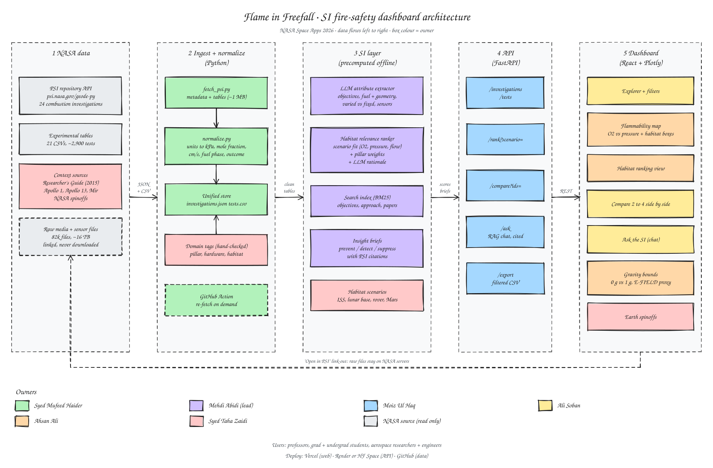

# 1. What we are building

An SI-powered web dashboard that turns NASA's microgravity combustion data into fire safety answers for crewed habitats. A user picks a habitat (ISS, lunar base, pressurized rover, Mars habitat) and the dashboard shows which of the 24 PSI combustion investigations matter for it, what conditions they actually tested, where the data runs out, and what the findings mean for prevention, detection and suppression.

Challenge page: <https://www.spaceappschallenge.org/2026/challenges/flame-in-freefall/>

Repository: <https://github.com/Mehdi-Abidi/flame-in-freefall>

## The one-line pitch

> Lunar habitats will run at 30% oxygen or more. Almost every solid-material fire test flown on the ISS stopped at about 22%. Our dashboard shows that gap, ranks the experiments that come closest, and explains what they tell a habitat designer.

That claim comes from a first quick parse of the tables we already pulled. The data team must confirm it after normalization (task D3) before it goes into the video.

## What judges should see in 60 seconds

1. Pick "Lunar base" from a dropdown.
2. The flammability map (oxygen fraction against pressure) lights up with every ISS test as a dot and the lunar target as a shaded box. Few dots fall inside the box.
3. The ranked list shows the top investigations for that habitat, each with a two-line reason and a link to its PSI page.
4. Open "Compare" on FLEX and FLEX-2 to see what changed between them.
5. Ask the chat a question, for example "Which diluent put out droplet flames at lower oxygen, CO2 or helium?" The answer cites PSI accession numbers.

## Architecture



# 2. Team and ownership

| Member | Role | Owns | Backup for |
|---|---|---|---|
| **Mehdi Abidi** | Team lead, SI layer | LLM extraction, ranking engine, insight briefs, final merges, submission | API |
| **Syed Mufeed Haider** | Data engineer | PSI ingestion, table normalization, unified test matrix, data QA | SI layer |
| **Moiz Ul Haq** | Backend engineer | FastAPI service, `/ask` chat with citations, `/export`, API deployment | Data |
| **Ali Soban** | Frontend lead | React app shell, Explorer, Compare, Ask page, web deployment | Viz |
| **Ahsan Ali** | Data viz | Flammability map, habitat ranking view, gravity bounds panel | Frontend |
| **Syed Taha Zaidi** | Domain and pitch | Fire-safety tags, habitat scenarios, Earth spinoffs, demo video, slides, submission text | QA |

The roles are a starting point. If someone is stronger elsewhere, swap at kickoff and update this table.

Box colours in the architecture diagram (`docs/architecture.svg`) match these owners.

# 3. Timeline (Pakistan time, PKT)

Space Apps 2026 runs 14 to 15 November. A third-party listing says submissions close **Sunday 15 November at 23:59 local time**. We could not confirm this on an official page, so Mehdi checks the official Project Submission Guide at kickoff. **Our internal deadline is Sunday 20:00.** The last four hours are buffer only.

## Saturday 14 November

| Time | Block | Everyone delivers |
|---|---|---|
| 13:30 to 14:30 | **Kickoff call** | Read this plan, clone the repo, install tools, confirm roles. Mehdi confirms the deadline and the team page on the Space Apps site. |
| 14:30 to 18:30 | **Sprint 1: foundations** | See section 4, column S1. |
| 18:30 to 19:00 | Sync 1 and dinner | Each person shows what runs. Blockers get an owner. |
| 19:00 to 23:30 | **Sprint 2: first end to end** | Real data flows from `data/processed` through the API into the UI. |
| 23:00 | Checkpoint | **v0 deployed** on a public link, ugly is fine. |
| 23:30 to 00:00 | Sync 2 | Decide what gets cut if we are behind. |
| 00:00 to 07:30 | Sleep | Everyone gets at least 6 hours. Tired code costs more than it saves. |

## Sunday 15 November

| Time | Block | Everyone delivers |
|---|---|---|
| 08:00 to 08:15 | Standup | Yesterday, today, blockers. |
| 08:15 to 13:00 | **Sprint 3: features complete** | See section 4, column S3. |
| 13:00 | Checkpoint | **v1 deployed** with every page working. |
| 13:00 to 15:00 | Sprint 4: polish | Copy, empty states, loading states, mobile check, insight text. |
| **15:00** | **Feature freeze** | Only bug fixes after this point. |
| 15:00 to 18:00 | Ship the story | Bug bash (all), demo video and slides (Taha, Ahsan), submission text (Taha, Mehdi). |
| 18:00 to 20:00 | **Submit** | Mehdi submits. Everyone checks the live link from their own phone. |
| 20:00 to 23:59 | Buffer | Emergencies only. |

# 4. Task board

Task IDs are used in branch names and PR titles, for example `mufeed/D2-normalize`.

## Data: Syed Mufeed Haider

| ID | Sprint | Task | Done when |
|---|---|---|---|
| D1 | S1 | ~~Run `python pipeline/fetch_psi.py` and note units per column for every CSV.~~ **Done 14 Nov.** | See `docs/data-notes.md`. |
| D2 | S1 | ~~Write `pipeline/normalize.py` that builds `data/processed/tests.csv`.~~ **Done 14 Nov.** 2,127 rows, plus `saffire2_gravity.csv`. | Mufeed reviews the output and the quirks list in `docs/data-notes.md`. |
| D3 | S2 | ~~Build `data/processed/investigations.json` with ranges computed from `tests.csv`.~~ **Done 14 Nov** (Mufeed, review fixes by Mehdi). | `qa.py` investigation checks pass. |
| D4 | S2 | ~~Data QA script: counts per investigation, missing values, unit sanity checks.~~ **Done 14 Nov.** 22 checks including spot checks against raw tables. | `python pipeline/qa.py` prints ALL CHECKS PASSED. |
| D5 | S3 | Merge `extracted.json` into `investigations.json`. Pillars come from Taha's `data/domain/tags.json` when present, and the model's pillars are only a fallback. | One file the frontend and API both read. |

Known quirks to handle: pressure appears in mmHg (FLEX), atm (FLEX-2, Flame Design), bar (CFI-G) and text such as "1 atm" (CFI). Oxygen appears as a mole fraction, as a percent, and as "% by vol". Some cells are blank or hold notes. FLEX-2 and the SAFFIRE tables need string cleanup before numbers parse.

## SI layer: Mehdi Abidi

| ID | Sprint | Task | Done when |
|---|---|---|---|
| S1 | S1 | ~~`si/llm.py` with one provider wrapper.~~ **Done 14 Nov.** Groq, `openai/gpt-oss-20b` with `gpt-oss-120b` as fallback, JSON mode, retries, cache. | `python -m si.llm --check` prints OK. |
| S2 | S1 | ~~Extraction of all 24 investigations.~~ **Done 14 Nov.** `python -m si.extract` writes `data/processed/extracted.json` (prompt s2-v4, GPT-OSS 20B). Table facts are given as ground truth, varied and fixed conditions come from `tests.csv`, summaries may not contradict them, invented fuels or sensors are flagged, and detection needs smoke, aerosol, particle, dust or detector evidence. | 24/24 extracted, QA checks pass, review list in `docs/extraction-review.md`. |
| S3 | S2 | ~~Ranking engine in `si/rank.py`, scored for 5 habitat scenarios.~~ **Done 14 Nov.** Habitats live in `data/domain/scenarios.json`, output in `data/processed/rankings.json`, rebuilt and checked in CI. | `python -m si.rank --scenario lunar_base` puts the high-oxygen investigations on top. |
| S4 | S2 | Rationale writer: two sentences per investigation per scenario, citing the fields used. | Stored in `investigations.json`. |
| S5 | S3 | Insight briefs per pillar (prevention, detection, suppression) with PSI citations. | Three briefs Taha has reviewed. |
| S6 | S4 | Merge PRs, deploy checks, submission. | Submitted. |

Every LLM output is precomputed and committed. The live site calls an LLM only for the chat. If the API key dies during judging, everything except chat keeps working.

## API: Moiz Ul Haq

| ID | Sprint | Task | Done when |
|---|---|---|---|
| A1 | S1 | FastAPI skeleton in `api/` that loads `investigations.json` and `tests.csv` at startup. Endpoints `/investigations`, `/investigations/{id}`, `/tests?accession=&o2_min=&o2_max=&p_min=&p_max=`. Mock data until D2 lands. | `uvicorn api.main:app` serves JSON locally. |
| A2 | S2 | `/rank?scenario=&w_prevent=&w_detect=&w_suppress=` calling `si.rank.rank()` with inputs loaded once at startup. `UsageError` becomes HTTP 400, other `RankError` becomes 500. `/compare?ids=PSI-69,PSI-68`. | Frontend can call both. |
| A3 | S2 | Deploy to Render or a Hugging Face Space. Add CORS for the frontend domain. | Public API link in the README. |
| A4 | S3 | `/ask`: BM25 search (`rank-bm25`, tiny install) over objectives, approach, summaries and publication titles. Top 5 chunks go to the LLM with the instruction to answer only from them and cite accession numbers. | Answers show citations. Questions with no answer in the data get "not covered in PSI data". |
| A5 | S3 | `/export?accession=...` returns filtered rows of `tests.csv` as CSV for modelers. | Download works from the UI. |

## Frontend: Ali Soban

| ID | Sprint | Task | Done when |
|---|---|---|---|
| F1 | S1 | ~~App shell.~~ **Done 14 Nov** as Next.js 16 static export in `web/` (paper and night themes, IBM Plex, Motion). | Live at mehdi-abidi.github.io/flame-in-freefall |
| F2 | S1 | ~~Deploy.~~ **Done 14 Nov:** GitHub Pages through `.github/workflows/dashboard.yml` (lint, type-check, tests, build on PRs, deploy from main). | Ali: polish and responsive QA |
| F3 | S2 | ~~Explorer.~~ **Done 14 Nov:** search, pillar, phase and platform filters, plus a static page per investigation. | Ali: copy and empty states |
| F4 | S3 | ~~Compare.~~ **Done 14 Nov:** up to 4, 16 attributes, differences marked, selection in the URL. | |
| F5 | S3 | Ask page: chat UI against Moiz's `/ask` endpoint. The static site cannot hold the key, so this waits for A3 and A4. | Works against `/ask`. |

## Visualization: Ahsan Ali

| ID | Sprint | Task | Done when |
|---|---|---|---|
| V1 | S1 | ~~Flammability map.~~ **Done 14 Nov** as the gap map: hand-built SVG, log pressure axis, habitat boxes, measured versus assumed dots. | |
| V2 | S2 | ~~Real data and hover.~~ **Done 14 Nov:** nearest-point tooltips, phase filters, table view. | Ahsan: tune labels and density |
| V3 | S2 | ~~Habitat ranking view.~~ **Done 14 Nov:** habitat switcher, sliders and presets, animated re-ordering, score bars, evidence. Browser ranking matches Python on all 120 scores. | |
| V4 | S3 | ~~Gravity panel.~~ **Done 14 Nov** as the SAFFIRE-II table on the overview. Next: add the E-FIELD partial-gravity note and LUCI/FM2 outlook as a chart. | Ahsan |

## Domain and pitch: Syed Taha Zaidi

| ID | Sprint | Task | Done when |
|---|---|---|---|
| T1 | S1 | Hand-check the seed tags in section 8 against the PSI pages and the 2015 Researcher's Guide. Write `data/domain/tags.json`. | All 24 tagged with pillar, hardware and platform. |
| T2 | S1 | Write `data/domain/scenarios.json` with the habitat targets in section 7, each with its source sentence. | Reviewed by Mehdi. |
| T3 | S2 | Earth spinoffs page content: water mist extinguishers, the shuttle-era smoke detector that tells dust from smoke (link to SAME and DAFT), firefighter clothing, air tanks. Plus a short history strip: Apollo 1, Apollo 13, Mir, Artemis II alarm. | Text in `web/src/content/`. |
| T4 | S3 | Review all 24 LLM extractions and the three insight briefs for factual errors. Start with the rows in `docs/extraction-review.md` that are not `agree` and every warning there. | Corrections merged. |
| T5 | S4 | Demo video and slides (section 10). Submission text draft. | Files in `docs/submission/`. |

# 5. Rules that keep us fast

1. **Never download raw PSI files.** The raw media and sensor files total about 16 TB across 82,330 files. We use only metadata and experimental tables (under 1 MB). Raw files are linked with "Open in PSI", never stored. If your laptop is short on disk, work in a GitHub Codespace.
2. **Branches:** `name/TASKID-short-name`. Open a PR into `main`. Mehdi merges. Small PRs, many times a day.
3. **No direct pushes to `main`** after kickoff, except Mehdi during the submission window.
4. **Data contracts are frozen** once section 6 is agreed at kickoff. Changing a field name needs a message in the team chat first.
5. **Mock first.** Frontend and API start on fake JSON in the agreed schema. Nobody waits for anybody.
6. **No secrets in Git.** API keys go in `.env` (ignored) locally and in the host's secret settings when deployed.
7. **Feature freeze is real.** After Sunday 15:00 only bug fixes merge.
8. **Cite everything.** Every number or claim in the UI links back to a PSI accession or a NASA source.

# 6. Data contracts

## `data/processed/tests.csv` (one row per test)

| Column | Type | Notes |
|---|---|---|
| row_id | str | unique key, e.g. `PSI-69-0001` |
| accession | str | e.g. `PSI-69` |
| acronym | str | e.g. `FLEX` |
| test_id | str | as given in the source table |
| date | str | ISO date if known |
| fuel | str | e.g. methanol, heptane, ethylene, cotton-fiberglass |
| fuel_phase | enum | `solid`, `liquid`, `gas` |
| geometry | str | droplet, flat sample, rod, coflow burner, spherical burner |
| size_mm | float | droplet diameter, sample thickness or burner size |
| o2_mole_fraction | float | 0 to 1 |
| pressure_kpa | float | converted from mmHg, atm, bar |
| diluent | str | N2, CO2, He, mixtures |
| flow_cm_s | float | blank if quiescent |
| gravity | enum | `micro`, `1g` |
| outcome | str | extinction, disruption, ignited, no ignition, self-extinguished |
| burn_time_s | float | |
| source_file | str | CSV name in `data/raw/tables` |
| record_type | enum | `test`, `test_day`, `test_day_condition`, `condition_matrix`, `session` |
| o2_source | enum | `measured`, `planned`, `approximate`, `test_day_list`, `nominal_cabin_air` |
| pressure_source | enum | `measured`, `planned`, `nominal_cabin`, `nominal_1atm` |
| n_flames | float | flames ignited on a test day (ACME day tables) |
| notes | str | anything that does not fit a column |

Only `measured` values count as evidence. Plot everything else as hollow markers. Details in `docs/data-notes.md`.

## `data/processed/investigations.json` (one object per investigation)

```json
{
  "accession": "PSI-69",
  "acronym": "FLEX",
  "title": "Flame Extinguishment Experiment",
  "project_type": "Microgravity Investigation",
  "platform": "ISS",
  "hardware": "CIR / MDCA",
  "pillars": ["suppression"],
  "fuel_phase": ["liquid"],
  "summary": "plain-language paragraph",
  "variables_varied": ["oxygen fraction", "pressure", "diluent", "droplet size"],
  "variables_fixed": ["quiescent atmosphere"],
  "sensors": ["color camera", "radiometer"],
  "o2_range": [0.12, 0.34],
  "o2_basis": "measured",
  "pressure_kpa_range": [70.2, 309.3],
  "pressure_basis": "measured",
  "n_tests": 274,
  "n_records": 274,
  "n_experimental_tables": 1,
  "n_files": 8853,
  "publications": [{"title": "...", "authors": "..."}],
  "psi_url": "https://psi.nasa.gov/physci/repo/data/investigations/PSI-69",
  "scores": {"lunar_base": 0.71},
  "rationale": {"lunar_base": "two sentences"}
}
```

Summary fields (pillars, summary, variables, sensors) come from S2. Scores and rationale come from S3 and S4.

Rules (checked by `qa.py`):

- `n_tests` counts only rows with `record_type = test`. `n_records` counts every row, including test days and FLEX-2's planned matrix.
- Ranges use measured values whenever any exist. Otherwise they use the next best tag, and `o2_basis` / `pressure_basis` name it (`nominal_cabin_air`, `planned`, `approximate` and so on). The UI must show the basis next to any range that is not measured.
- `platform` is one of `ISS`, `Cygnus`, `Space Shuttle`, `ground`.

# 7. Habitat scenarios and ranking

## Targets (from the challenge text, stored in `data/domain/scenarios.json`)

| Scenario | O2 | Pressure | Note |
|---|---|---|---|
| ISS and Earth-normal cabin | 21% | 14.7 psi (101 kPa) | baseline |
| Lunar base | 30% or more | 10.2 psi or less (70 kPa) | challenge text |
| Pressurized rover | 30% or more | 10.2 psi or less (70 kPa) | challenge says same range as the base |
| Mars habitat | 30% or more | 10.2 psi or less (70 kPa) | **our assumption**, label it in the UI |
| Spacesuit | 100% | 4.3 psi (30 kPa) | context only, no PSI tests come close |

A useful fact for the map: oxygen partial pressure is about the same in the ISS cabin (0.21 × 14.7 = 3.1 psi) and the lunar base (0.30 × 10.2 = 3.1 psi). The oxygen fraction is what rises, and flammability tracks the fraction strongly. That is why lunar habitats are more dangerous even though the "amount of oxygen" looks similar.

## Score

For each investigation *i* and scenario *s*:

**score = 0.35 × condition fit + 0.20 × material relevance + 0.25 × pillar match + 0.20 × data richness**

| Part | How it is computed |
|---|---|
| Condition fit | Distance from each test to the habitat box, counted in tolerances (0.05 O2 fraction, 20 kPa), turned into a closeness from 0 to 1. Measured values count fully, approximate 0.7, planned 0.6, assumed cabin values 0.5, missing pressure 0.75. Fit is half the best test and half the typical test. |
| Material relevance | 1.0 for solid cabin materials (fabrics, plastics), 0.7 for liquids, 0.5 for gas flames. Habitat fires start in solids. |
| Pillar match | The investigation's best single pillar divided by the user's top slider weight. **Changed from the first draft** (a dot product), which let investigations with more tags outrank focused ones even with no tests near the habitat. |
| Data richness | Log-scaled count of tests, files and publications, normalized to 0 to 1. |

Weights are shown in the UI so a judge can see exactly why something ranks first. The LLM writes the explanation. It does not set the score.

# 8. Seed tags for the 24 investigations

Taha verifies these in T1. Hardware groupings come from the challenge text.

| Accession | Acronym | Pillar (seed) | Hardware |
|---|---|---|---|
| PSI-26 | BASS | prevention, suppression | MSG, SPICE flow duct |
| PSI-25 | BASS-II | prevention, suppression | MSG, SPICE flow duct |
| PSI-98 | SAFFIRE-I | prevention, detection | Saffire unit in Cygnus |
| PSI-99 | SAFFIRE-II | prevention | Saffire unit in Cygnus |
| PSI-100 | SAFFIRE-III | prevention, detection | Saffire unit in Cygnus |
| PSI-102 | SAME | detection | MSG |
| PSI-101 | SAME-R | detection | MSG |
| PSI-47 | DAFT / DAFT-2 | detection (dust vs smoke) | SAME instrument |
| PSI-69 | FLEX | suppression | CIR, MDCA |
| PSI-68 | FLEX-2 | suppression | CIR, MDCA |
| PSI-39 | CFI | prevention (cool flames) | CIR, MDCA |
| PSI-20 | ACME BRE | prevention | CIR, ACME |
| PSI-159 | ACME CFI-G | prevention (up to 85% O2) | CIR, ACME |
| PSI-10 | ACME Flame Design | prevention (soot, O2 enriched) | CIR, ACME |
| PSI-21 | ACME CLD Flame | fundamentals | CIR, ACME |
| PSI-22 | ACME E-FIELD Flames | partial-gravity proxy | CIR, ACME |
| PSI-23 | ACME s-Flame | fundamentals | CIR, ACME |
| PSI-107 | SPICE | detection (smoke point) | MSG, SPICE flow duct |
| PSI-106 | SLICE | fundamentals | MSG, SPICE flow duct |
| PSI-60 | ground: SPICE analysis | detection | ground |
| PSI-62 | ground: flame spread modeling | prevention | ground |
| PSI-115 | ground: SAME data use | detection | ground |
| PSI-117 | ground: cool flame dynamics | fundamentals | ground |
| PSI-142 | ground: cool flame transitions | prevention | ground |

# 9. Tech stack and setup

| Layer | Choice | Why |
|---|---|---|
| Data | Python 3.11+, standard library and pandas | Small data, no heavy installs |
| SI | Groq free tier, open-weight GPT-OSS 20B behind `si/llm.py`, BM25 search | No local models, no GPU, no big downloads. Provider is a `.env` setting. |
| API | FastAPI on Render or a Hugging Face Space | Free tier, quick deploy |
| Web | React, Vite, TypeScript, Tailwind, Plotly | Fast to build, good charts |
| Hosting | Vercel for `web/` | Preview link per PR |

Setup at kickoff:

```bash
git clone https://github.com/Mehdi-Abidi/flame-in-freefall.git
cd flame-in-freefall
python -m venv .venv
.venv\Scripts\activate          # Windows
pip install -r requirements.txt
python pipeline/fetch_psi.py    # optional, data is already committed
```

Frontend members run `npm install` inside `web/` once Ali has scaffolded it. `node_modules` takes a few hundred MB. If that is a problem, use a Codespace.

# 10. Submission

## Checklist

Confirm the exact fields in the 2026 Project Submission Guide. Past Space Apps events asked for the items below.

- [ ] Team registered and all six members on the team page
- [ ] Project title and short summary
- [ ] Demo: a short video or a small slide deck (past years: 30 seconds or up to 7 slides)
- [ ] Final project link: live dashboard URL and this GitHub repo
- [ ] Detailed description: what it does, how it works, benefits, tools used
- [ ] NASA data used, with links to the PSI investigations
- [ ] References and other sources
- [ ] Use of AI disclosure (which tools, for what)
- [ ] No NASA logos or insignia in our materials
- [ ] Live link tested on two phones and one laptop, logged out

## Judging criteria (as in past years)

Influence, Creativity, Validity, Relevance, Presentation. Map each one to a feature in the video: relevance is the lunar habitat story, validity is the citations and visible scoring weights, creativity is the gravity bounds and the gap map.

## Video storyboard (30 seconds)

| Seconds | Shot | Line |
|---|---|---|
| 0 to 4 | Apollo 1, Mir, Artemis II alarm quote on screen | "Fire is still one of the worst things that can happen in space." |
| 4 to 10 | Map with lunar box | "Lunar habitats will run at 30% oxygen. Most solid-material tests stopped near 22%." |
| 10 to 18 | Rank view, sliders move | "We rank 24 NASA combustion investigations for any habitat, with reasons." |
| 18 to 25 | Ask page with cited answer | "Ask a question, get an answer tied to NASA data." |
| 25 to 30 | Team slide, link | Project name, URL. |

# 11. Risks

| Risk | Plan |
|---|---|
| PSI API goes down | All data needed is already committed to the repo. |
| LLM rate limit or key failure | Extraction is precomputed. Only chat depends on a live key. |
| LLM states something wrong | Every field cites its source. Taha reviews all 24 (T4). |
| API host cold start during judging | Frontend falls back to static JSON. Open the API link 5 minutes before judging. |
| Scope creep | Section 1 lists what judges must see. Anything else is optional. |
| Low disk space | Codespaces. No raw data downloads. |
| Deadline confusion | Mehdi confirms the official time at kickoff. Internal deadline is 20:00. |

# 12. Stretch goals (only after v1 is live)

1. Uncertainty bands on the map showing where microgravity and 1 g results bound partial gravity.
2. "Design check" mode: enter a material and a cabin atmosphere, get the nearest tests and a plain warning level.
3. One-click PDF brief for a chosen habitat.

# Sources

- Challenge page: <https://www.spaceappschallenge.org/2026/challenges/flame-in-freefall/>
- PSI repository: <https://psi.nasa.gov/physci/repo/search?data_source=psi&data_type=investigation>
- PSI search API used by our pipeline: `https://psi.nasa.gov/geode-py/ws/repo/search`
- PSI database guide: <https://assets.science.nasa.gov/content/dam/science/bps/bps-general/bps-data_osdr_psi/Complete_PSI_Database_Guide.pdf>
- NASA PSI on the AWS Registry of Open Data (holds no combustion data): <https://registry.opendata.aws/nasa-psi>
